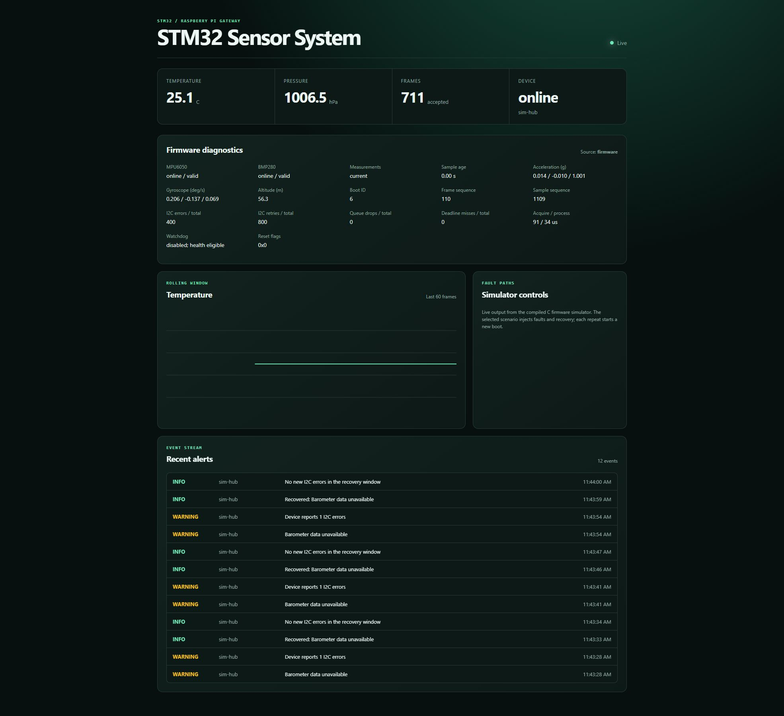

# STM32 Sensor Hub and Networked Monitoring System

[](https://github.com/RohitPatel97/stm32-networked-sensor-system/actions/workflows/ci.yml)

A complete software path from embedded C sensor acquisition to a live network
dashboard: **STM32F401RE / FreeRTOS -> UART JSON -> Python gateway -> REST and
WebSocket -> browser**. MPU6050 and BMP280 drivers acquire at 100 Hz; telemetry
publishes at 10 Hz. The compiled C simulator exercises the same driver,
processing, sensor-state, and telemetry code without a board.

This project combines the two original repositories without modifying them.
Their source revisions and file hashes are recorded in
[provenance](docs/PROVENANCE.md). This repository is independent: no source
checkout from either original is required to build or run it.

## Run the complete demo

For the prepared Windows demo, double-click **STM32 Sensor Lab** on the Desktop.
One Windows app starts Renode, checks live telemetry and contains the dashboard,
22 selectable component tests, fault controls and saved HTML/JSON evidence.
Use **Run all tests** inside the app. Closing its window stops its gateway and
Renode; reopening preserves your reports. Opening it twice brings forward the
existing window. **Launch Sensor Lab.cmd** in this folder opens the same app.
See the
[Sensor Lab guide](docs/SENSOR-LAB.md), [three-minute walkthrough](docs/INTERVIEW-DEMO.md)
and [desktop validation](docs/validation/DESKTOP-APP-20261020.md).

To execute the **actual Cortex-M4 / FreeRTOS ELF in Renode**, use the
[Renode setup and test guide](docs/RENODE.md). On the configured Windows workspace:

```powershell
.venv/Scripts/python.exe scripts/renode_demo.py --port 8765
```

The dashboard shows `Source: renode`. This uses emulated MPU6050/BMP280 I2C
registers, STM32 interrupts, and USART2; the host C simulator remains available below.

Requirements: Python 3.11+, CMake 3.20+, and a C99 compiler. Node.js is needed only
for the dashboard integration test. From this repository's root:

```sh
git clone https://github.com/RohitPatel97/stm32-networked-sensor-system.git
cd stm32-networked-sensor-system
python -m venv .venv
# Linux/macOS:
source .venv/bin/activate
# Windows PowerShell:
# .\.venv\Scripts\Activate.ps1
python -m pip install -r requirements-lock.txt
python -m pip install -e "./gateway[dev]"
cmake -S firmware -B build/host -DCMAKE_BUILD_TYPE=Release
cmake --build build/host --config Release --parallel
python scripts/demo.py --scenario recovery
```

Open <http://127.0.0.1:8000>. The demo streams **new output from the compiled C
program directly into the gateway's production UART decoder**. No conversion
file is needed. It uses host pacing at 10 frames/s; simulated acquisition/timing
values are deterministic models, not measured MCU execution times.

For a Visual Studio multi-configuration build, add
`--binary build/host/Release/sensor_hub_sim.exe`. With a single-configuration
Windows build, the default is `build/host/sensor_hub_sim.exe`.

| Scenario | Behavior |
| --- | --- |
| `recovery` | IMU disappears at 3 s and recovers at 7 s; barometer continues |
| `barometer` | Temperature/pressure become `n/a`; acceleration continues |
| `stalled` | Acquisition stops at 3 s; UART continues, measurement age increases |
| `normal` | Continuous healthy samples |

Scenarios repeat by executing a new simulator process with a greater boot ID.
`--once` ends acquisition after one scenario; retained history remains available
and readiness correctly returns 503. `--boot-id N` selects the initial simulated
boot. Simulator identity is demonstrative and resets with a new demo process;
physical firmware uses its own persistent journal.



## What is integrated

- One [v3 UART contract](protocol/README.md) with an exported JSON Schema,
  generated C fixtures, strict validation, and cross-language regressions.
- Stable board identity and a persistent boot counter. Old sessions, duplicate
  frames, downgrades, and backward samples cannot refresh health or alerts.
- Separate transmitted-frame and acquired-sample sequences. Health continues
  arriving when acquisition stalls, without making old measurements fresh.
- Partial sensor records, including both sensors absent, remain valid. Missing
  values are explicit `null` and render as `n/a`, with gaps in the chart.
- Cumulative counters remain available after recovery. Current error alerts
  clear after one second of producer time without a new counter increment.
- Gyroscope, altitude, I2C retries, deadline misses, timing, watchdog eligibility,
  reset flags, sample age, and boot identity reach the API and dashboard.
- Existing bounded history, client queues, alerts, serial reconnect framing,
  REST routes, and gateway v1/v2 compatibility remain available.

```text
firmware/          C core, simulator, STM32 target, and firmware tests
gateway/           Python service, browser dashboard, legacy tools/tests
protocol/          Shared UART specification, JSON Schema, generated fixture
tests/integration/ Compiled C -> gateway -> API/WebSocket regression tests
tests/dashboard.cjs Production dashboard exercised with real received events
scripts/           Demo, schema export, validation, original-integrity check
deploy/            Combined-project service configuration
docs/              Architecture, provenance, and observed validation evidence
```

## Verify the combined project

```sh
python scripts/verify.py
```

Run this after the host build. It runs firmware CTest, all gateway/integration
tests, schema-drift checking, and gateway lint. CI also cross-compiles STM32
images with the hardware watchdog disabled and enabled.

See [the validation record](docs/VALIDATION.md) for commands, observed results,
and limits. The browser was also inspected against a running local service.

For sustained memory, WebSocket reconnect, serial-lifecycle, and reboot checks,
see [stress testing](docs/STRESS-TESTING.md). The runners save resource samples,
failure accounting, and source hashes for repeatable comparisons.

## Connect a physical board

Build the target with Arm GNU 13.2.Rel1 on PATH:

```sh
cmake -S firmware -B build/stm32 -G Ninja -DCMAKE_TOOLCHAIN_FILE=cmake/arm-none-eabi.cmake -DHUB_BUILD_STM32=ON -DCMAKE_BUILD_TYPE=MinSizeRel
cmake --build build/stm32 --parallel
```

PowerShell should quote the `-DCMAKE_TOOLCHAIN_FILE=...` argument. The linker
reserves flash sector 7 for the boot journal. **Read the [boot provisioning
policy](protocol/README.md#boot-identity-and-provisioning) before flashing:**
ordinary updates must preserve that sector; an intentional journal/mass erase
requires a new `HUB_DEVICE_EPOCH` and therefore a new device identity.

For a Linux/Pi gateway, install the gateway package and set:

```sh
SENSOR_MONITOR_SOURCE=serial SENSOR_MONITOR_SERIAL_PORT=/dev/ttyACM0 sensor-monitor serve
```

Use the matching COM port on Windows. The firmware's USART2 uses PA2 TX / PA3 RX
at 115200 8N1; select the board's virtual COM port or a suitable 3.3 V adapter.
Pin/wiring details and the watchdog gate are in the
[target guide](firmware/target/stm32f401re/README.md).

Physical flashing, power-interruption behavior, UART transport, sensor timing,
watchdog resets, and a Pi soak remain unverified. Firmware cross-compilation and
host tests establish software/build behavior only. Gateway state is in memory
and resets on restart; sender identity is not authenticated.
