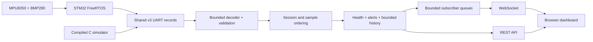

# Architecture

The C firmware core owns sensor drivers, retry policy, sample processing, sensor
status, boot journaling, and bounded telemetry formatting. The STM32 adapter owns
FreeRTOS scheduling, interrupts, peripheral calls, silicon identity, and flash.
The compiled host simulator replaces the board's I2C/time/scheduling environment
while using the same core and formatter.

The gateway owns bounded UART framing, schema validation, session/sample
ordering, current health, retained history, alerts, and subscriber backpressure.
Serial reconnection resets framing, never identity or accepted history. V3
normalization preserves the complete firmware record and exposes convenient
temperature/pressure/acceleration API fields. There is no live converter process.

The system distinguishes communication age, measurement age, sensor availability,
and task health. New telemetry may carry an unchanged sample plus updated task
diagnostics. It advances the frame baseline but not the sample timestamp.
Missing sensor payloads do not erase valid data from the other sensor or falsely
report temperature recovery. Cumulative error totals are historical evidence;
recent counter increments and availability drive current faults.

Legacy gateway v1/v2 and FreeRTOS schema-1 tools remain for existing captures.
They do not participate in the combined demo's v3 path. Root CI builds/tests
both components and their integration; nested imported CI files are historical
component references and are not executed by GitHub as repository workflows.

Persistent gateway storage, authenticated ingress, automatic flash-journal
reclamation, remote control of the MCU, and physical acceptance are outside
this implementation. The target build and host tests establish specific
software properties; neither measures the hardware's timing or power behavior.
