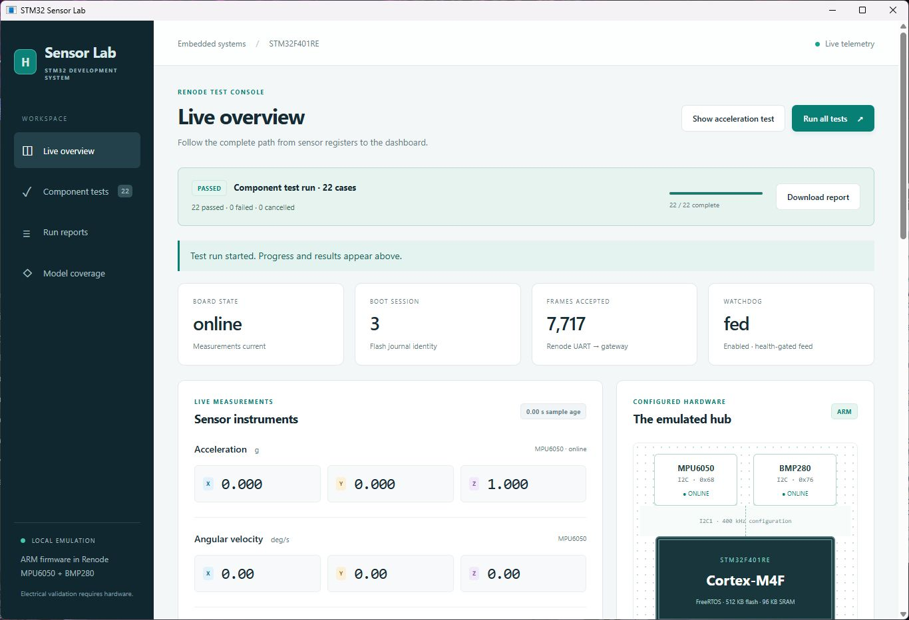
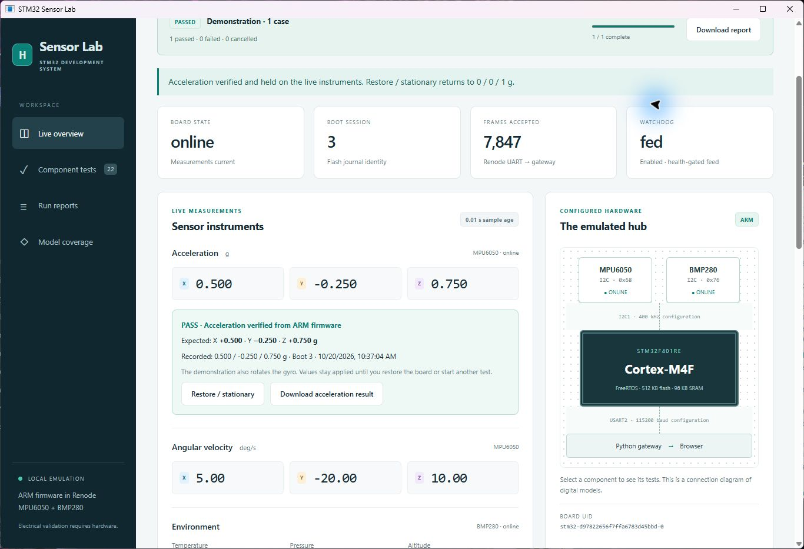

# Full suite and visible acceleration demonstration

Verified on October 20, 2026 in the native **STM32 Sensor Lab** app.

- Clicked **Run all tests** in the app. Run `20261020T173541-9d85f027`
  completed with **22 passed, 0 failed, 0 cancelled**, including the 30-second
  stability observation. The controls were disabled during execution and enabled
  after cleanup. The accelerometer case observed `[0.5, -0.25, 0.75] g`, exactly
  matching its expected vector.
- Clicked the new **Show acceleration test** control. The embedded UI selected
  the acceleration chart, scrolled to the live instruments and displayed a PASS
  with expected/recorded axes, Boot ID, timestamp and a report link.
- The demonstration writes real Renode MPU6050 registers through the existing
  verified `motion` action. It exercises the ARM driver, telemetry, gateway and
  native display. Gyro values simultaneously become `[5, -20, 10] deg/s`.
- A later API sample, **19.9 seconds** after the verified sample, still showed
  `[0.5, -0.25, 0.75] g` with advancing sequence and unchanged Boot ID 3.
- Clicked **Restore / stationary** in the new panel. The resulting report passed;
  live acceleration returned to `[0, 0, 1] g`, gyro to `[0, 0, 0] deg/s`, and both
  sensors stayed online. The earlier acceleration evidence remained visible as a
  timestamped recorded result.
- `node --check demo/web/lab.js` passed. The original integrity check again
  verified all 116 source files unchanged. This change modifies the UI and
  documentation; firmware, backend and the 22-case catalog are unchanged.

Evidence:

- [Complete suite JSON](acceleration-demo-20261020/full-suite.json) and
  [printable HTML](acceleration-demo-20261020/full-suite.html).
- [Acceleration report](acceleration-demo-20261020/acceleration.json) and
  [printable HTML](acceleration-demo-20261020/acceleration.html).
- [Held-value samples](acceleration-demo-20261020/held-values.json).
- [Stationary recovery report](acceleration-demo-20261020/restore.json).

The display demonstration holds its injected values for presentation. The
automated accelerometer test remains a quick repeatable assertion and restores
the stationary baseline along with the rest of the suite. These are digital
register/driver tests, not physical sensor calibration or motion simulation.
