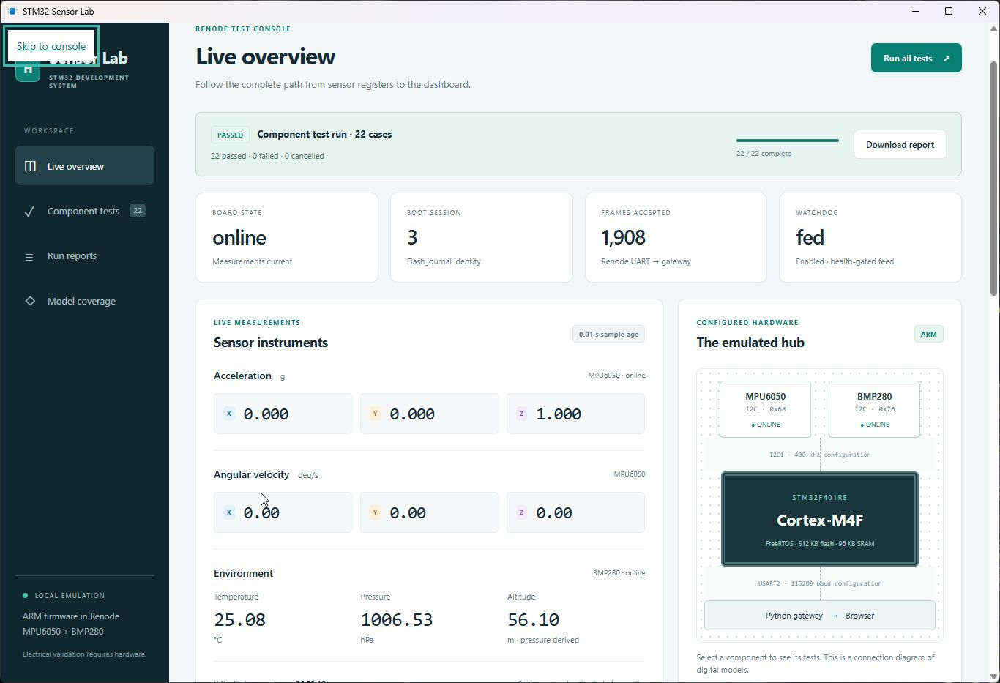

# Consolidated desktop app — October 20, 2026

The prepared Windows checkout now has one Desktop shortcut, **STM32 Sensor Lab**.
It opens `build/desktop/SensorLab.exe`, which embeds the live dashboard, component
tests, fault demonstrations, coverage map and report archive. Renode and the
Python gateway run in the background. The three former desktop command launchers
were moved into `demo/legacy-launchers/desktop/`; both original projects remain
unchanged.

## Observed validation

| Check | Result and evidence |
| --- | --- |
| Native app launch | Compiled x64 WinForms/WebView2 host; actual ARM firmware preflight passed and the live UI appeared in a single native window. |
| Duplicate launch | A second launch exited and restored the existing app window. Its gateway PID and virtual board session remained unchanged. |
| Full Renode suite | **22/22 passed**, including sensor scaling/faults, GPIO/RCC/TIM2/SysTick, heap/stacks, flash identity, reboot, UART reconnect, watchdog and stability. See [JSON](desktop-20261020/full-suite.json) and [HTML](desktop-20261020/full-suite.html). The suite was triggered through the CLI against the native app's running gateway and observed in its embedded UI. |
| Native window shutdown | The app logged acquisition stopped and then “Desktop closed cleanly”; its gateway and Renode exited. See [launch/close log](desktop-20261020/native-launch-close.txt). |
| Private lifecycle channel | **4/4 passed** with real Renode launches: EOF before startup, close during startup, close during a suite, and restart/report persistence followed by EOF shutdown. See [lifecycle evidence](desktop-20261020/lifecycle.json). |
| Interrupted suite | The active stability check and pending reboot check were saved as cancelled. The port could be rebound, and a fresh gateway returned the same report. See [saved report](desktop-20261020/cancelled-on-close.json). |
| Final native build | Reopened successfully with 22 catalog entries, the passed full-suite report and cancelled lifecycle report available. See [final state](desktop-20261020/final-app.json). |
| Host regression | **276 Python tests and 4 CTest groups passed**; schema/fixture checks, gateway lint and JavaScript syntax passed. [Commands, outputs and source/binary hashes](desktop-host-20261020.json). A pre-existing Starlette/httpx deprecation warning remains. |
| Original preservation | `scripts/check_originals.py` verified all **116** original source files unchanged. |



## Packaging and lifecycle

The host uses the existing local UI and backend, so it has one telemetry path and
one test implementation. A per-project mutex prevents duplicate app instances.
If the matching CLI gateway already exists, the window attaches without taking
ownership. A different service on port 8765 produces a startup error and Retry.

For an owned gateway, a private stdin handshake waits until Windows job assignment
before starting Renode. Closing the window cancels an active test, awaits report
and emulator cleanup, and closes the process job. The job is configured to
terminate its children if the host exits abruptly. The native abrupt-exit fallback
was not separately fault-injected in this run; graceful native closure and the
private channel's cancellation/EOF paths were exercised.

`scripts/build_desktop.ps1 -InstallShortcut` reproducibly builds the app and
installs the shortcut. It pins Microsoft WebView2 SDK 1.0.4258.31, verifies the
NuGet archive SHA256, preserves its license and prior native binary, and fails if
compilation fails. Windows .NET Framework 4.8 and the installed Edge WebView2
runtime provide the host UI.

This is one installed app experience for the prepared checkout. The EXE still
depends on the project Python environment, Renode, firmware ELF, WebView2 DLLs
and UI sources. Copying only the EXE to another machine is not sufficient.
Digital emulation coverage and physical hardware limitations are unchanged;
see the [Sensor Lab guide](../SENSOR-LAB.md).

To repeat the real backend shutdown tests:

```powershell
.venv/Scripts/python.exe scripts/check_desktop_lifecycle.py
```

That script uses a separate free port and preserves its JSON evidence. It does
not shut down an already running interview app.
