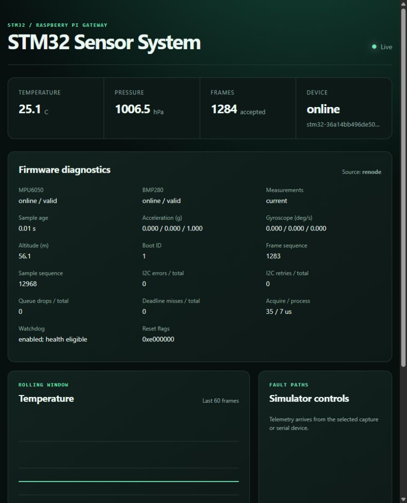

# Renode ARM-to-dashboard validation — October 17, 2026

**Passed:** 1,045 ARM-generated UART frames, nine acceptance groups, five boot
sessions, five TCP reconnects, and one IWDG-triggered reset. No parser errors,
sequence anomalies, device rejections, or WebSocket queue drops were observed.
The actual watchdog-enabled STM32F401RE ELF ran under Renode 1.17.0 with the
FreeRTOS kernel and STM32 HAL. The host simulator was not the producer.

## Issues found and corrected

1. **Invalid JSON on the ARM target.** newlib-nano does not implement `%llu`.
   It emitted literal `lu` and misread subsequent variadic arguments, corrupting
   boot ID, uptime, timestamp and later fields. The shared C formatter now
   converts uint64 values explicitly into its bounded output buffer. Native
   regression tests cover zero, UINT64_MAX, exact-fit buffers and every
   truncation point. Renode verified boot IDs `9007199254741093` through
   `9007199254741097` through the real ARM formatter and decimal-string API.
2. **Telemetry starvation during sensor faults.** HAL polling timeouts and
   retries can exceed the 10 ms acquisition period. The highest-priority sensor
   task then repeatedly consumed an already-pending timer semaphore without
   blocking. In the failing run, output stopped after frame 48 when the IMU was
   removed. The task now blocks for one tick on an overrun, allowing processing,
   telemetry and health to execute. The same fault now produces live offline/null
   records, followed by recovery when the sensor is reattached.
3. **False startup health alert.** A telemetry frame at 1001 ms could run before
   the first lower-priority 1 Hz health check. The gateway now gives an unobserved
   check two periods, while immediately reporting recorded deadline misses after
   the initial grace period. Four regressions cover startup and real failures.
   The final real-firmware run and live dashboard had no startup alert.
4. **Emulation reset mapping.** The platform aliases flash at address zero for
   BOOT0=0 reset vector fetches. MCU resets retain the journal and stable UID.

## Observed tests

| Test | Result |
| --- | --- |
| Healthy ARM firmware | 25.08 C, 1006.53 hPa, `[0,0,1]` g; watchdog fed |
| Sensor register changes | 0.5 g, 10 deg/s and 28.25 C reached WebSocket |
| IMU unplug/replug | Offline/null then online; barometer continued |
| Barometer unplug/replug | Offline/null then online; IMU continued |
| Both sensors unplug/replug | Valid partial telemetry continued; recovered |
| Three MCU resets | Stable device ID; journal increment; frame sequence zero |
| Five UART disconnects | Reconnected, preserving device/session history |
| Stalled TIM2 acquisition | IWDG logged reset; next boot resumed and fed watchdog |
| 60-second steady phase and WS reconnect | Continuous accepted frames; snapshot then updates |

The acceptance scenario ran 105 virtual seconds in total. Its final API counters
were 1,045 accepted frames, four session changes, five source reconnects and zero
parser/order/rejection/drop errors. Every raw UART line also passed the production
parser after emulator shutdown. A real browser showed `Live`, `Source: renode`,
both sensors online, current measurements and no alert transitions; its console
error query was empty. The saved live API later showed 1,424 accepted frames
with no parser/order/drop errors.

Full host verification passed **263 Python tests and four CTest suites**, schema
and generated-fixture checks, and gateway lint. A dependency deprecation warning
about Starlette's httpx test client remains. Both ARM watchdog configurations
compiled and passed the image-layout checks: watchdog off uses 39,204 flash
bytes, watchdog on 39,316; both use 32,464 RAM bytes. The watchdog-on ELF SHA-256
is `46598310fdb612481b9822c262aadf6730b7827a6f275a23415122bf34458372`.

All 116 original source hashes still match the pre-integration manifest; both
original Git working trees remain clean.

## Reproduction and evidence

Run from the combined project root, after building the watchdog-enabled target:

```powershell
python scripts/test_renode.py --output build/renode-new-run --soak-seconds 60
python scripts/verify.py
python scripts/check_originals.py
python scripts/renode_demo.py --port 8765
```

- [Acceptance report](renode-20261017/report.json)
- [All 1,045 raw firmware frames](renode-20261017/uart.jsonl)
- [Renode monitor, including the watchdog reset](renode-20261017/monitor.txt)
- [Host checks and source/binary hashes](renode-20261017/host-verification.json)
- [Emulation/integration source hashes](renode-20261017/integration-source-sha256.json)
- [Installed Renode package metadata](renode-20261017/setup.json)
- [Invalid target output before the formatter fix](renode-20261017/before-formatter-fix.jsonl)
- [Failed sensor-outage test before the scheduling fix](renode-20261017/before-starvation-fix.json)
- [Live API snapshot](renode-20261017/live-api.json)



## Limits

The custom sensors model the digital registers used by these drivers. They do
not prove physical sensor or electrical behavior. Timing derives from Renode's
fixed clock model and is not a hardware measurement. Flash retains across MCU
resets in the running emulator, but the launcher creates a fresh board UID and
journal on each new process. Upstream RCC reset-cause bits are not faithful to
the triggering cause; use the IWDG log and boot-counter transition as emulation
evidence, and validate reset_flags physically. This test establishes functional
recovery, not an exhaustive memory-leak or physical power-cut qualification.
See [the setup/model guide](../RENODE.md) for details.
